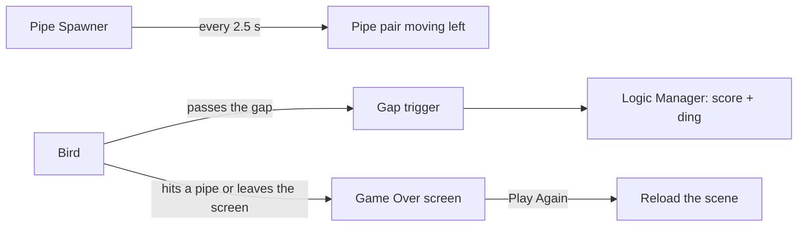

# Flappy Bird-Style Game in Unity

A 2D side-scroller in Unity and C#: press Space to keep the bird in the air, fly through the gaps between pipes to score, and hit Play Again after a crash. Self-study project, July 2024, following Game Maker's Toolkit's [The Unity Tutorial For Complete Beginners](https://www.youtube.com/watch?v=XtQMytORBmM).

This repository is a project showcase, not a maintained library.

## Demo

No recording yet. To try it, download the Windows build from [Releases](https://github.com/naimulnashid/unity-flappy-bird-tutorial/releases/latest).

## Features

- **Flap:** Space sets the bird's upward velocity; gravity on its `Rigidbody2D` pulls it back down.
- **Pipes:** a spawner creates a pipe pair every 2.5 seconds at a random height within 8 units of its own, and each pair moves left at 5 units per second until it is destroyed off screen.
- **Score:** a trigger between the pipes adds a point and plays a ding when the bird (layer 3) passes through.
- **Game over:** hitting a pipe, or leaving the screen by more than 15 units up or down, shows the Game Over screen and stops the flap input.
- **Play Again and Quit** buttons: Play Again reloads the scene; Quit closes the built game.

## Installation and getting started

**Play:** download `flappy-bird-windows-x64.zip` from [Releases](https://github.com/naimulnashid/unity-flappy-bird-tutorial/releases/latest), unzip it and run `My project.exe` (64-bit Windows). The build is unsigned, so Windows SmartScreen may ask you to confirm.

**Open the project:** install Unity 2022.3 (the build used 2022.3.25f1) through [Unity Hub](https://unity.com/download), then:

```bash
git clone https://github.com/naimulnashid/unity-flappy-bird-tutorial.git
```

In Unity Hub choose **Add project from disk**, pick the cloned folder, and open `Assets/Scenes/SampleScene.unity`. The first open takes a few minutes while Unity rebuilds its `Library` cache.

## Configuration

No configuration needed. Tuning values are public fields you can change in the Inspector: `flapStrangth` (10) on the bird, `spawnRate` (2.5 s) and `heightOffset` (8) on the Pipe Spawner, and `moveSpeed` (5) and `deadZone` (-49) on the pipe prefab.

## Usage

| Key or button | Action |
|---|---|
| Space | Flap |
| Play Again | Restart after a crash |
| QUIT | Close the game (build only; it does nothing inside the editor) |

## Tech stack and architecture

Unity 2022.3, C#, 2D physics (`Rigidbody2D`, colliders and a trigger), and the legacy uGUI `Text` and `Button` components.

| Script | Attached to | Job |
|---|---|---|
| [`BirdScript.cs`](Assets/BirdScript.cs) | Bird | Flap input, off-screen and collision checks |
| [`PipeSpawnScript.cs`](Assets/PipeSpawnScript.cs) | Pipe Spawner | Spawns the pipe prefab on a timer at a random height |
| [`PipeMoveScript.cs`](Assets/PipeMoveScript.cs) | Pipe prefab | Moves the pipes left and destroys them off screen |
| [`PipeMiddleScript.cs`](Assets/PipeMiddleScript.cs) | Pipe prefab, gap trigger | Adds a point when the bird passes |
| [`LogicScript.cs`](Assets/LogicScript.cs) | Logic Manager (tag `Logic`) | Score text, ding sound, game over and restart |
| [`QuitButton.cs`](Assets/QuitButton.cs) | Quit button | Calls `Application.Quit()` |



## Security and privacy

The game runs offline. It reads no files, collects nothing and opens no network connections.

## Development

The project is complete and not under development. The original repository held only the `Assets` folder and a committed Windows build. On 2026-11-22 the project was moved to the repository root, the build moved to [Releases](https://github.com/naimulnashid/unity-flappy-bird-tutorial/releases), and the missing project files were added: the Unity version, the `Logic` tag, layer 3, the scene in the build list and the package manifest. Those additions were written by hand and not opened in Unity, so the first open may adjust them. One text that used a bundled copy of Arial now uses Unity's built-in font.

## Credits, license and support

- Game design, scripts and structure follow [The Unity Tutorial For Complete Beginners](https://www.youtube.com/watch?v=XtQMytORBmM) by Game Maker's Toolkit (Mark Brown).
- The bird and pipe sprites (`unitytut-birdbody.png`, `unitytut-pipe.png`) are the tutorial's assets.
- Flappy Bird is a game by Dong Nguyen; this is a learning exercise in the same style, not affiliated with it.
- No license is granted for this repository: it is shared to show the work, not for reuse.
- This is a personal showcase, so issues and pull requests are not monitored.
